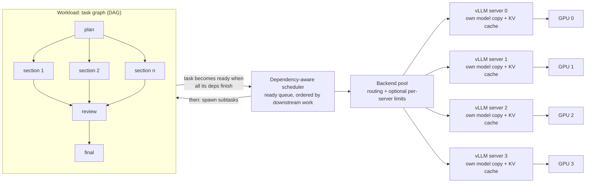

# GPU Parallel Orchestrator

A dependency-aware scheduler for multi-agent LLM workloads that runs across a pool of independent inference servers.

<p align="center">
  <picture>
    <source media="(prefers-color-scheme: dark)" srcset="docs/benchmarks/hero-dark.svg">
    
  </picture>
</p>

You describe a job as a graph of tasks: plan, fan out into parallel subtasks, review, summarise. The orchestrator starts each task as soon as its own dependencies have finished. It sends the task to one of several OpenAI-compatible inference servers (vLLM, SGLang, llama.cpp or similar), each running its own copy of the model on its own GPU or GPU group.

**The problem.** Agent workloads are rarely one long request. They are many requests with partial ordering: some must wait for others, and many could run at the same time. Run them stage by stage and the GPUs idle while each stage drains. Run them all through one sharded server and every request pays for cross-GPU synchronisation.

**The approach.** The usual way to use several GPUs for one model is to shard it with tensor parallelism (TP) and run one server. This project also supports the alternative: when the model fits on one GPU (or a small group), run independent **replicas** and let the orchestrator spread ready tasks across them. Neither layout is better in general. The right choice depends on model size, VRAM left after the weights, interconnect bandwidth, KV-cache capacity and the shape of the workload. The orchestrator works with either layout, and the included benchmark measures which is better on your hardware.

> [!IMPORTANT]
> **This is not GPU memory pooling.** Each inference server holds its own full copy of the model and its own KV cache in its own GPU memory, and nothing is shared between servers. The orchestrator pools *inference capacity* (request slots across servers), not physical VRAM. A model that doesn't fit in one server's memory still needs tensor or pipeline parallelism inside that server.

## Contents

- [Key results](#key-results)
- [Why this approach matters](#why-this-approach-matters)
- [When to use it](#when-to-use-it)
- [Architecture](#architecture)
- [Benchmark results](#benchmark-results)
- [Features](#features)
- [Installation and quick start](#installation-and-quick-start)
- [Usage examples](#usage-examples)
- [Benchmarking your own hardware](#benchmarking-your-own-hardware)
- [Implementation details](#implementation-details)

## Key results

Measured on 4× RTX 3090 24 GB (no NVLink) with Qwen3.8-27B (4-bit) on vLLM 0.32.0, running 24 agent teams (239 dependent tasks). Every row used the same workload, seed and client-side dependency scheduler. Only the server layout and the orchestrator's limits changed.

| Configuration | Completion time (lower is better) | Speed-up | Time saved |
| --- | ---: | ---: | ---: |
| Baseline: one vLLM server, tensor parallel across 4 GPUs | 257.6 s | 1.00× | — |
| 4 independent replicas + orchestrator, learned limit (8 per GPU) | 183.0 s | 1.41× | 29.0% |
| 4 independent replicas + orchestrator, no limits | **177.1 s** | **1.45×** | **31.2%** |

> [!NOTE]
> **What we found, including what didn't work**
> - **Replicas won.** Four replicas finished the job 31.2% sooner (a 1.45× speed-up) than one TP=4 server.
> - **Adaptive concurrency didn't help.** The learned limits were no faster than leaving limits off (183.0 s vs 177.1 s, within run-to-run variation).
> - **Prefix-aware routing didn't help.** It did not beat round-robin on real hardware (666.2 s vs 652.6 s at 96 teams).
> - **Memory was the bottleneck.** Each GPU ran at most ~20 requests at once, half the configured 40, because its KV cache was full. See [Bottleneck analysis](#bottleneck-analysis).
>
> Each configuration was run once. See [Limitations](#limitations).

## Why this approach matters

The orchestrator aims for the **shortest time to finish the whole workload**, not the largest number of agents running at once. It does that by:

1. **Starting tasks as soon as their dependencies are satisfied**, rather than waiting for a whole stage to finish.
2. **Prioritising tasks with the most downstream work.** The priority is the longest estimated chain of dependent output tokens after a task, so the critical path doesn't queue behind less urgent work.
3. **Distributing requests across inference servers**, optionally preferring the server that already has the request's prompt prefix cached.
4. **Optionally capping requests in flight per server.** Excess work then waits in the orchestrator's priority queue rather than in an unordered server queue.
5. **Recording the critical path** of every run, so you can see which chain of tasks set the total time.

**More concurrency is not the same as more useful throughput.** A batching server shares each read of the model weights across every request in the batch, so tokens per second rises with batch size. That holds until compute saturates or the KV cache fills. Past that point, extra requests only queue, or slow every stream down.

In the benchmark, raising the limit from 8 to 32 per GPU did raise mid-run throughput, from about 160 to about 230 output tokens/s per GPU. But each task took about 3× longer. That stretched the longest dependency chain by about as much as the throughput gained, so total time barely changed.

## When to use it

**It is a good fit when:**

- the workload is **multi-step agent work with dependencies**, where many tasks become ready at different times;
- you have **several GPUs without a fast interconnect**, and the model fits on one GPU (or a pair) with KV-cache room to spare, so independent replicas are an option;
- you want **visibility** into where the time goes: per-task timelines, queue waits, the critical path and saved metrics.

**It will not help much when:**

- you have **one server and independent requests**. vLLM's continuous batching already schedules those well, and in our tests the orchestrator's limits added nothing on top;
- the job is **bound by a long dependency chain**. When the remaining tasks are waiting on each other, only faster single-stream generation shortens the job;
- the model **doesn't fit on a single GPU or GPU group** with room for KV cache. Then each server needs tensor parallelism, and the replica layout may not be possible.

### Choosing a server layout

| Situation | Layout to try first |
| --- | --- |
| Model leaves several GB of KV-cache room on one GPU | One replica per GPU |
| Model barely fits on one GPU (e.g. a 27B 4-bit model on 20 GB cards) | One replica per GPU pair (TP=2), then compare |
| Model doesn't fit on two GPUs, or the GPUs have NVLink | One tensor-parallel server |

These are starting points, not conclusions. [Measure your own hardware](#benchmarking-your-own-hardware).

## Architecture



1. **Task graph.** Holds tasks and their dependencies. A prompt can be a string or a function of the dependencies' outputs. A finished task can add new tasks (subagents) while the job runs.
2. **Scheduler.** When a task's last dependency finishes, the task becomes *ready* and enters a priority queue ordered by downstream work. Whenever a slot is free, the scheduler starts the highest-priority ready task. If a task fails, only the tasks that depend on it are cancelled.
3. **Backend pool.** Picks a server for each request: by prompt-prefix affinity (default), least loaded, or round robin. Each server can have a fixed or adaptive limit on requests in flight.
4. **Inference servers.** Independent processes, each with its own model copy, KV cache and batching scheduler. A server can span several GPUs internally (for example TP=2). The orchestrator only sees an HTTP endpoint.

<p align="center">
  
</p>

Without NVLink, a tensor-parallel server exchanges activations between GPUs over PCIe in every layer of every decoding step. Independent replicas avoid that exchange entirely. The cost is a full model copy on every GPU, which leaves less room for KV cache.

## Benchmark results

All figures in this section come from [`docs/benchmarks/vast-4x3090-runs.csv`](docs/benchmarks/vast-4x3090-runs.csv) (exported from the run database), the vLLM server logs and the per-run HTML timelines. The full write-up is in [docs/benchmarks/vast-4x3090.md](docs/benchmarks/vast-4x3090.md).

### Hardware and software environment

| Item | Value |
| --- | --- |
| GPUs | 4× NVIDIA RTX 3090, 24 GB each (23.56 GiB reported by vLLM), no NVLink; rented Vast.ai instance |
| Model | [RedHatAI/Qwen3.8-27B-INT4](https://huggingface.co/RedHatAI/Qwen3.8-27B-INT4): 4-bit (compressed-tensors), hybrid attention + Mamba-style layers |
| Inference server | vLLM 0.32.0 |
| Replica servers | One per GPU: `--max-model-len 8192 --max-num-seqs 40 --max-num-batched-tokens 2048 --enable-prefix-caching --gpu-memory-utilization 0.92` |
| Baseline server | One server: `--tensor-parallel-size 4 --max-model-len 8192`, other settings at vLLM defaults |
| Client | `scripts/bench.py`, sampling temperature 0.7 |

### Experimental workload

Each **agent team** works from its own shared brief, a 1–3k-token system prompt, and runs four steps:

1. **Plan**: one task, 200 output tokens.
2. **Write**: 4–10 section tasks of 250–600 output tokens each. All become ready when the plan finishes and run in parallel.
3. **Review**: one task that waits for every section, 500 output tokens.
4. **Final**: one task that waits for the review, 400 output tokens.

Every task inherits its team's brief, so each team shares a cacheable prompt prefix.

| Run size | Tasks | Output tokens | Prompt tokens |
| --- | ---: | ---: | ---: |
| 24 teams (standard) | 239 | 96,826 | ~527k |
| 96 teams (heavy) | 972 | ~393k | ~2.08M |

The task graph comes from a fixed seed, so every run sends the same prompts with the same token limits. Every request ran to its `max_tokens` limit (output totals were identical across runs), so throughput figures compare like for like.

This is a common agentic pattern. Bursts of parallel work sit between synchronisation points, and a dependency chain (plan → section → review → final) bounds how fast any single team can finish.

> [!NOTE]
> **What "orchestrator" means in each row.** Every run was driven by the same dependency-aware scheduler in `bench.py`, the baseline included. The baseline ran in `--unmanaged` mode against the single TP=4 endpoint: no limits, every ready task sent immediately. So the headline comparison isolates the **server layout**. In the replica rows, the orchestrator's job is to make four separate servers work as one pool.

### Real hardware results

**24 teams (239 tasks):**

| Run | Layout | Orchestrator setting | Completion time | Output tokens/s |
| ---: | --- | --- | ---: | ---: |
| 9 | 1 server, TP=4 | no limits (baseline) | 257.6 s | 375.8 |
| 1 | 4 replicas | fixed limit 4 per GPU | 241.2 s | 401.3 |
| 2 | 4 replicas | fixed limit 8 per GPU | 192.2 s | 503.8 |
| 3 | 4 replicas | fixed limit 16 per GPU | 195.4 s | 495.6 |
| 4 | 4 replicas | fixed limit 32 per GPU | 187.2 s | 517.2 |
| 5 | 4 replicas | adaptive, cold start | 193.4 s | 499.7 |
| 6 | 4 replicas | adaptive, warm start | 188.6 s | 513.4 |
| 7 | 4 replicas | adaptive, warm start | 187.3 s | 517.0 |
| 8 | 4 replicas | learned limit (8 per GPU), frozen | 183.0 s | 529.2 |
| 10 | 4 replicas | no limits, round-robin | **177.1 s** | **546.6** |

<p align="center">
  
</p>

**96 teams (972 tasks):**

| Run | Layout | Orchestrator setting | Completion time | Output tokens/s | Prefix-cache hits |
| ---: | --- | --- | ---: | ---: | ---: |
| 11 | 4 replicas | no limits, round-robin | 652.6 s | 602.0 | 10.8% |
| 12 | 4 replicas | limit 40 per GPU, prefix-aware routing | 666.2 s | 589.6 | 7.2% |

Prefix-cache hits are the share of prompt tokens served from vLLM's cache. They were recorded from run 10 onward (11.9% in run 10).

**What these runs show:**

- **Layout.** Four replicas beat the TP=4 server in every configuration except the deliberately low limit of 4 per GPU.
- **Concurrency limits.** From 8 per GPU upward, every setting finished within 177–195 s. The adaptive controller settled on 8 for all four GPUs. Its learned curves (138–183 output tokens/s per GPU at 8, lower at 16) describe this workload, not the cards' capacity.
- **Prefix-aware routing.** No measurable benefit at 96 teams. The managed run was 2% slower and had fewer cache hits.
- **Dependency tail.** In every 24-team timeline, the last ~30% of the run had far fewer tasks running (about 8 instead of 32), while reviews and final summaries waited on their inputs.

### Bottleneck analysis

The vLLM logs explain why the orchestrator's limits and routing made little difference: **the GPUs ran out of KV-cache memory before they ran out of request slots.**

<p align="center">
  
</p>

| Per GPU, from the vLLM logs | Value |
| --- | --- |
| Total memory reported | 23.56 GiB |
| Model weights | 16.5 GiB (16.8 GiB including CUDA context and other non-PyTorch memory) |
| KV cache available | 4.28 GiB = 60,757 tokens |
| KV block size | 1,568 tokens (raised to match the Mamba state page size) |
| Blocks available | ~38 |
| Peak running requests | 20 on GPUs 0 and 1, with up to 152 waiting inside vLLM |

- **Hybrid layers force large blocks.** vLLM stores attention KV and Mamba-style state in shared pages, which forces 1,568-token blocks. A request with a 1–3k-token prompt plus up to 600 output tokens needs about two blocks. So roughly 20 requests fit in ~38 blocks, whatever `--max-num-seqs` says.
- **Cached prefixes don't survive.** With every block in use, cached prompt prefixes are evicted almost immediately. Prefixes are also cached only in whole 1,568-token blocks. That explains the 7–13% hit rates, and why routing a team to "its" server couldn't keep its brief cached.
- **Limits had nothing to add.** vLLM was already queueing everything beyond ~20 requests and batching the rest well. Holding requests back in the orchestrator, at 8 or at 40, changed little.

> [!TIP]
> **Engineering takeaway.** In this configuration, neither orchestration overhead nor concurrency limits dominated; free GPU memory after the weights did. Future gains are more likely to come from more KV-cache room than from finer concurrency tuning: an FP8 KV cache, a smaller or non-hybrid model, or TP=2 pairs on smaller cards. Faster single-stream decoding would shorten the dependency tail. Prefix-aware routing should be re-tested on servers with room to keep prefixes cached.

### Simulator experiments

> [!WARNING]
> **Illustrative only: not hardware measurements, and not predictions.** These numbers come from `SimulatedBackend`, with speed curves scaled from third-party reports before any real hardware was tested. The simulator assumed prefix caching always works, which the real benchmark contradicted.

The simulator is still useful for developing and testing scheduling, routing, batching and concurrency behaviour without GPUs. It runs whole workloads in seconds on a shared simulated clock.

**Routing across 4 simulated cards** (`examples/demo_multi_gpu.py`, 8 agent teams sharing ~6k-token prompts, 80 tasks):

| Strategy | Simulated makespan | Prefix-cache hits |
| --- | ---: | ---: |
| round robin | 57.1 s | 34 / 80 |
| least loaded | 57.1 s | 34 / 80 |
| prefix-aware | 43.4 s | 53 / 80 |

**Adaptive concurrency** (`examples/demo_adaptive.py`): 800 requests with 250–2,500-token prompts and 100–500-token answers, on 4 simulated cards. "Cold" means the controllers start knowing nothing; "warm" means they start from the curve learned in the cold run.

| Limit per card | Preset A (27B on 20 GB, estimate) | Preset B (peaked curve, hypothetical) |
| --- | ---: | ---: |
| fixed 4 | 501.9 s | 398.6 s |
| fixed 8 | 286.9 s | 230.3 s |
| fixed 16 | **206.4 s** | 157.8 s |
| fixed 32 | 209.3 s | **142.5 s** |
| fixed 64 | 215.2 s | 147.8 s |
| adaptive, cold | 252.4 s | 193.5 s |
| adaptive, warm | 213.6 s | 147.2 s |

In simulation, the warm controller lands within about 3% of the best fixed limit without being told where it is. A 96-team simulated run also predicted that prefix-aware routing would win by about 18%. On real hardware it did not (run 12 vs run 11 above).

### Limitations

- **One hardware configuration, one workload.** The 1.45× result was measured on 4× RTX 3090 without NVLink, with one hybrid 27B model and one synthetic agent workload. Model architecture, quantisation, GPU memory, interconnect, server flags and task dependency structure can all change the outcome.
- **One run per configuration.** With no repetitions there is no median, spread or confidence interval. The spread among near-equivalent runs (177–195 s) suggests run-to-run variation of several percent.
- **Baseline flags differ.** The TP=4 baseline used vLLM defaults apart from context length, while the replicas used tuned `--max-num-seqs` and `--max-num-batched-tokens`. The TP=4 server's own logs were not kept.
- **Replicas need the model to fit.** Each replica must hold the full model plus useful KV cache. Tensor parallelism remains necessary for models that don't fit on one GPU or GPU group, and can be the better choice with a fast interconnect.
- **Prefix-aware routing is unproven on real hardware.** It has not yet shown an advantage outside simulation.
- **No GPU utilisation or power data.** Only vLLM's logged queue and KV-cache figures were captured.

### Future benchmarking objectives

Future runs should report the following, which this run did not measure:

- [ ] At least 5 independent repetitions per configuration, with the median, minimum, maximum and standard deviation of completion time
- [ ] GPU utilisation, peak VRAM and power per GPU over the run (for example, sampled `nvidia-smi`)
- [ ] Time-to-first-token, alongside total generated tokens and output tokens/s (the latter two are already recorded)
- [ ] A TP=4 baseline with the same `--max-num-seqs` and `--max-num-batched-tokens` as the replicas, with its server logs kept
- [ ] TP=2 pairs, an FP8 KV cache, and a non-hybrid model of similar size
- [ ] PCIe generation and lane width per GPU, plus driver and CUDA versions

## Features

- **Dependency-driven scheduling.** Tasks start when their own dependencies finish, ordered by downstream work.
- **Dynamic subagents.** A finished task can spawn subtasks, a merge step, or a whole fan-out.
- **Multi-server pool.** Prefix-affinity, least-loaded or round-robin routing across any number of OpenAI-compatible endpoints.
- **Optional admission control.** Fixed or adaptive per-server limits on requests in flight, plus a cap on uncached prompt tokens in flight.
- **Observability.** SQLite metrics store, learned speed curves, critical-path analysis and self-contained HTML timelines.
- **Simulator.** A continuous-batching server simulation with a shared clock, a prefix cache, a KV-cache limit and batch slots.
- **Minimal dependencies.** Pure Python 3.10+ and asyncio; `httpx` only for real HTTP servers.

## Installation and quick start

```bash
git clone https://github.com/TomaDev1/GPU-Parallel-Orchestrator
cd GPU-Parallel-Orchestrator
pip install -e .[dev]
python -m pytest
```

Try it without a GPU:

```bash
python examples/demo_simulated.py      # one simulated server
python examples/demo_multi_gpu.py      # 4 simulated cards, routing strategies compared
python examples/demo_adaptive.py       # adaptive concurrency vs fixed limits
python examples/demo_metrics.py        # two runs with a metrics DB, then timeline.html
```

Against a real server:

```bash
python examples/demo_server.py --base-url http://localhost:8000/v1 --model <name>
```

## Usage examples

### A task graph

```python
from orchestrator import Scheduler, SimulatedBackend, Task, TaskGraph

g = TaskGraph()
g.add(Task("research", "Research X.", max_tokens=800))
g.add(Task("cpu", lambda d: f"Evaluate CPUs given: {d['research']}", deps=("research",)))
g.add(Task("gpu", lambda d: f"Evaluate GPUs given: {d['research']}", deps=("research",)))
g.add(Task("compare", "Compare.", deps=("cpu", "gpu")))

backend = SimulatedBackend(time_scale=100)
report = await Scheduler(backend, max_concurrency=8, clock=backend.now).run(g)
print(report.summary())
```

`cpu` and `gpu` start together the moment `research` finishes; `compare` starts when both are done.

### Subagents

```python
def plan_then(task, spawn):
    parts = [spawn.task(f"part{i}", f"Write section {i + 1}.") for i in range(6)]
    spawn.join("review", lambda d: "Review:\n\n" + "\n\n".join(d.values()), of=parts)

g.add(Task("plan", "Plan a 6-section report.", system=BRIEF, then=plan_then))
```

Spawned tasks depend on their parent, inherit its system prompt (and with it, its prefix-cache key), and get ids like `plan/part3`.

### Several servers

One OpenAI-compatible server per GPU, for example four vLLM instances on ports 8000–8003:

```python
from orchestrator import BackendPool, Endpoint, OpenAICompatibleBackend, Scheduler

pool = BackendPool([
    Endpoint(f"gpu{i}", OpenAICompatibleBackend(f"http://localhost:{8000 + i}/v1", "qwen"),
             max_concurrency=40)          # match the server's own --max-num-seqs
    for i in range(4)
])
report = await Scheduler(pool, max_concurrency=pool.capacity).run(graph)
```

> [!TIP]
> With vLLM, setting each endpoint's `max_concurrency` to the server's `--max-num-seqs` and letting vLLM batch was as fast as any lower limit in the benchmark.

### Metrics, learned limits and timelines

```python
from orchestrator import MetricsStore, write_timeline

with MetricsStore("metrics.db") as store:
    pool = BackendPool([
        Endpoint(f"gpu{i}", OpenAICompatibleBackend(f"http://localhost:{8000 + i}/v1", "qwen"),
                 controller=store.controller(f"gpu{i}", max_limit=64))
        for i in range(4)
    ])
    report = await Scheduler(pool, max_concurrency=pool.capacity).run(graph)
    store.save_run(report, pool, label="research batch")
write_timeline(report, "timeline.html")
```

`store.controller(name)` warm-starts from the speed curve learned in earlier runs, so only the first run pays for probing. Keep endpoint names stable, because saved curves are keyed by name. Start a new database after changing the model or quantisation.

## Benchmarking your own hardware

`scripts/launch_vllm.sh` starts one vLLM server per GPU, and `scripts/bench.py` runs the agent workload described above. Every run uses the same seed, so completion times compare directly.

```bash
# One vLLM server per GPU on ports 8000+ (logs in logs/; stop with ./scripts/launch_vllm.sh stop)
PYTORCH_CUDA_ALLOC_CONF=expandable_segments:True \
MODEL=RedHatAI/Qwen3.8-27B-INT4 MAX_MODEL_LEN=8192 \
EXTRA_ARGS='--limit-mm-per-prompt {"image":0,"video":0} --max-num-seqs 40 --max-num-batched-tokens 2048' \
./scripts/launch_vllm.sh

# Fixed limits, then adaptive runs, then a run frozen at the learned limit
python scripts/bench.py --limits 4,8,16,32 --max-limit 40

# Replicas with no orchestrator limits (round-robin, every ready task sent immediately)
python scripts/bench.py --unmanaged --limits "" --adaptive-runs 0

# One server spanning several GPUs, e.g. started with: vllm serve ... --tensor-parallel-size 4 --port 18000
python scripts/bench.py --endpoints http://localhost:18000/v1 --unmanaged --limits "" --adaptive-runs 0
```

Add `--teams 96` for the heavy workload. Results go to `bench-results/` (`summary.json` plus one `timeline-runN.html` per run) and `bench.db`. Each run's summary line includes its prefix-cache hit rate. To see the output format without GPUs, run `python scripts/bench.py --simulate`.

<details>
<summary><b>Practical notes for vLLM and rented GPUs</b></summary>

- Use a 4-bit build made for vLLM (AWQ, GPTQ, W4A16 or compressed-tensors). GGUF repositories don't load in vLLM.
- Allow at least 60 GB of disk for the model download.
- Hybrid models such as Qwen3.8 need `--max-num-seqs` at or below the number of Mamba cache blocks vLLM reports at startup (42 in our setup). Otherwise the server refuses to start.
- If a server runs out of memory while profiling, add `--max-num-batched-tokens 2048` and set `PYTORCH_CUDA_ALLOC_CONF=expandable_segments:True`.
- The launcher refuses to start if any GPU already has more than 2 GB in use, for example by a template's own vLLM server. Stop that server first, or set `FORCE=1`.
- Watch the `Running:`, `Waiting:` and `GPU KV cache usage` lines in the vLLM log. They show whether memory, rather than the request limit, is capping concurrency.
- Run inside `tmux` so a dropped SSH connection doesn't stop the benchmark.

</details>

## Implementation details

| Component | Module | What it does |
| --- | --- | --- |
| `Task`, `TaskGraph` | `graph.py` | Tasks, dependencies and states, plus a critical-path estimate: the sum of expected output tokens along the longest downstream chain. Tasks can be added mid-run. |
| `Scheduler`, `RunReport` | `scheduler.py` | Keeps ready tasks in a priority queue, ordered by critical-path estimate, then task priority, then insertion order. Starts tasks up to `max_concurrency`, and records ready, start and finish times, queue waits, tokens and cached tokens. |
| `Spawner` | `spawn.py` | `spawn.task`, `spawn.join` and `spawn.fan_out`, called from a task's `then` callback. Children inherit `system`, `prefix_key` and `max_tokens`. |
| `BackendPool`, `Endpoint` | `routing.py` | Routing strategies `prefix` (default), `least_loaded` and `round_robin`. Prefix routing prefers a server that recently served the same prefix key, unless it is more than `max_imbalance` requests busier than the least-loaded server. Supports fixed or adaptive per-endpoint limits and an optional budget for uncached prompt tokens. |
| `AdaptiveLimit` | `admission.py` | Measures throughput for each cohort of requests after a limit change. Doubles the limit while throughput keeps up, then explores ±1/8 around the best level, preferring the lowest level on a plateau. Can warm-start from a saved curve or freeze at the best known level. |
| `MetricsStore` | `metrics.py` | SQLite tables for runs, tasks, limit history and learned curves. |
| `write_timeline` | `timeline.py` | Self-contained HTML Gantt chart per server, showing queue waits with the critical path highlighted. |
| `OpenAICompatibleBackend` | `backends.py` | Async `/chat/completions` client built on httpx. Reads `usage.prompt_tokens_details.cached_tokens` to count prefix-cache hits. |
| `SimulatedBackend`, `SimClock` | `backends.py` | Continuous-batching simulation: per-request decode speed from a speed curve, a shared prefill rate, an LRU prefix cache, and optional KV-cache capacity and batch slots. |

**Critical path.** `report.critical_path()` walks back from the last task to finish, through whichever dependency it was actually waiting on. That chain set the total time, so it is where splitting work or speeding up generation pays off.

**Prompt budget.** `Endpoint(max_prefill_tokens=…)` caps the uncached prompt tokens in flight on a server. Prompt processing doesn't speed up with batching, so a burst of long prompts can otherwise stall generation for every request on that server. An idle server always admits one request, however long.
