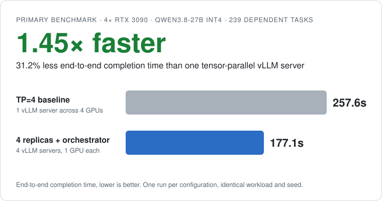
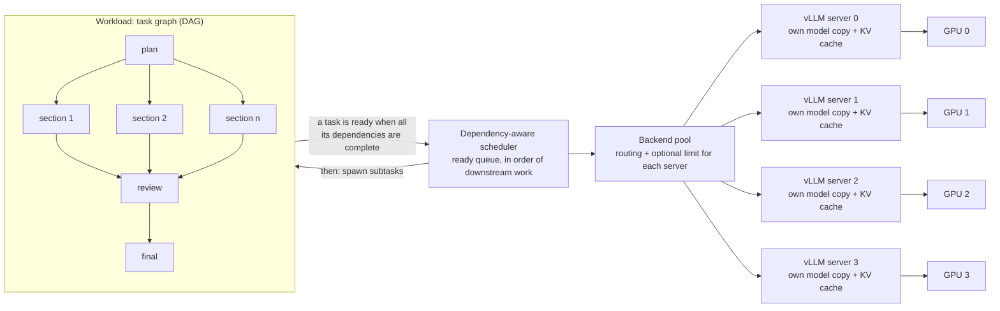
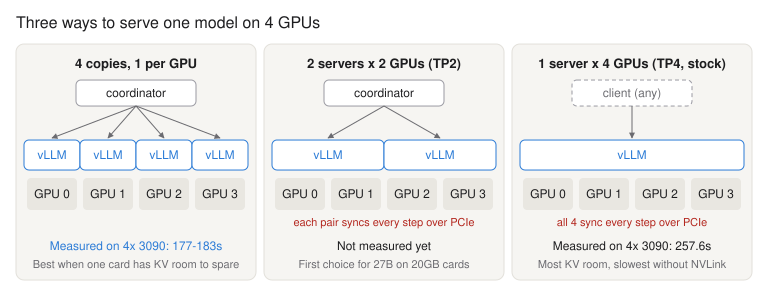
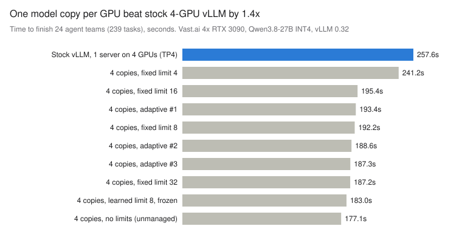
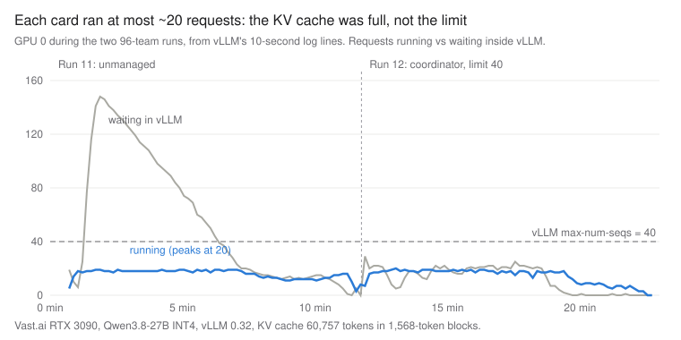

# GPU Parallel Orchestrator

This scheduler starts the tasks of a multi-agent LLM job in the order of their dependencies. It sends each task to one server in a pool of independent inference servers.

<p align="center">
  <picture>
    <source media="(prefers-color-scheme: dark)" srcset="docs/benchmarks/hero-dark.svg">
    
  </picture>
</p>

You write a job as a graph of tasks. For example: a plan, then parallel subtasks, then a review, then a summary. The orchestrator starts each task when all of its dependencies are complete. It sends the task to one server in a set of OpenAI-compatible **inference servers**. An inference server is a process that loads a model into GPU memory and answers generation requests through an HTTP API. Examples are vLLM, SGLang and llama.cpp. In this project, each server has its own copy of the model on its own GPU or GPU group.

**The problem.** An agent job is not usually one long request. It is many requests in a partial order. Some must wait for others. Many can run at the same time. If you run them one stage at a time, the GPUs sit idle while each stage drains. If you send them all to one server that splits the model across GPUs, every request pays for synchronization between those GPUs.

**The approach.** The usual method for one model on many GPUs is **tensor parallelism (TP)**. With TP, one server divides the weight matrices of each layer across the GPUs. The GPUs then exchange partial results in each layer of each step. This project also supports a different method. If the model fits on one GPU (or on a small group of GPUs), you can run independent **replicas**. A replica is a separate inference server with a full copy of the model. The orchestrator divides the ready tasks between the replicas.

Neither layout is better in general. The right choice depends on:

- the model size
- the free VRAM after the model weights load
- the interconnect bandwidth, which is the data rate between GPUs (for example, through **NVLink**, a direct GPU-to-GPU link, or through PCIe)
- the **KV cache** capacity. The KV cache is GPU memory that holds the attention keys and values for the tokens of each request. Its size sets how many requests a server can process at the same time.
- the structure of the workload.

The orchestrator works with either layout. Use the included benchmark to find out which one is faster on your hardware.

> [!IMPORTANT]
> **This is not GPU memory pooling.** Each inference server keeps a full copy of the model and its own KV cache in its own GPU memory. The servers do not share memory. The orchestrator pools *inference capacity*, which is the request slots on all servers. It does not pool physical VRAM. If a model is too large for the memory of one server, that server must use tensor parallelism or pipeline parallelism.

## Contents

- [Key results](#key-results)
- [Why this approach matters](#why-this-approach-matters)
- [When to use it](#when-to-use-it)
- [Architecture](#architecture)
- [Benchmark results](#benchmark-results)
- [Features](#features)
- [Installation and quick start](#installation-and-quick-start)
- [Usage examples](#usage-examples)
- [Benchmark your hardware](#benchmark-your-hardware)
- [Implementation details](#implementation-details)

## Key results

| Test item | Value |
| --- | --- |
| Hardware | 4× RTX 3090 24 GB, no NVLink |
| Model and server | Qwen3.8-27B (4-bit) on vLLM 0.32.0 |
| Workload | 24 agent teams (239 dependent tasks) |

Every row used the same workload, seed and client-side dependency scheduler. Only the server layout and the orchestrator limits changed.

| Configuration | Time to complete (lower is better) | Speed-up | Time decrease |
| --- | ---: | ---: | ---: |
| Baseline: one vLLM server, tensor parallel on 4 GPUs | 257.6 s | 1.00× | — |
| 4 independent replicas + orchestrator, learned limit (8 per GPU) | 183.0 s | 1.41× | 29.0% |
| 4 independent replicas + orchestrator, no limits | **177.1 s** | **1.45×** | **31.2%** |

> [!NOTE]
> **What we found, including what did not work**
> - **Replicas were faster.** Four replicas completed the job in 31.2% less time than one TP=4 server. This is a 1.45× speed-up.
> - **Adaptive concurrency did not help.** The learned limits were no faster than no limits at all (183.0 s vs 177.1 s). That gap is within run-to-run variation.
> - **Prefix-aware routing did not help.** On real hardware, it did not beat round-robin routing (666.2 s vs 652.6 s at 96 teams).
> - **Memory was the bottleneck.** Each GPU ran at most about 20 requests at once, half the configured limit of 40, because its KV cache was full. Refer to [Bottleneck analysis](#bottleneck-analysis).
>
> Each configuration had only one run. Refer to [Limitations](#limitations).

## Why this approach matters

The orchestrator aims for the shortest time to finish the whole workload, not the most agents running at once. It does five things:

1. **It starts a task when the dependencies of that task are complete.** It does not wait for a full stage to complete.
2. **It gives priority to the tasks on the critical path.** The **critical path** is the longest chain of dependent tasks. It sets the minimum total time of the job. The priority of a task is the estimated length, in output tokens, of the longest dependent chain after that task. Critical-path tasks therefore do not queue behind less urgent work.
3. **It divides the requests between the inference servers.** As an option, it selects the server that has the prompt prefix of the request in its **prefix cache**. A prefix cache keeps the KV cache entries of a prompt start, such as a shared system prompt. The server reuses these entries instead of computing them again.
4. **As an option, it sets a maximum number of requests in progress on each server.** Extra work then waits in the orchestrator's priority queue, not in the server's unordered queue.
5. **It records the critical path of each run.** The record shows the chain of tasks that set the total time.

**More concurrency does not always give more useful throughput.** vLLM uses **continuous batching**: at each decode step, it adds new requests to the batch and removes completed requests. One read of the model weights serves every request in the batch, so tokens per second rise with batch size. This holds until compute saturates or the KV cache fills. Past that point, extra requests only queue, or they slow every stream down.

In the benchmark, raising the limit from 8 to 32 per GPU raised mid-run throughput from about 160 to about 230 output tokens/s per GPU. But each task took about 3× longer. The critical path grew by about as much as throughput gained, so total time barely changed.

## When to use it

**Use it when:**

- the workload is **multi-step agent work with dependencies**, and many tasks become ready at different times
- you have **many GPUs without a fast interconnect**, and the model fits on one GPU (or two GPUs) with free KV cache space. Then independent replicas are possible.
- you must **see where the time goes**: the timeline of each task, the queue wait times, the critical path and the stored metrics.

**It does not help much when:**

- you have **one server and independent requests**. The continuous batching of vLLM already schedules these requests well. In our tests, the orchestrator limits added nothing on top.
- a **long dependency chain** sets the time of the job. If the remaining tasks wait for each other, only faster single-stream generation makes the job shorter.
- the model **does not fit on one GPU or GPU group** with space for the KV cache. Each server then needs tensor parallelism, and replicas may not be an option.

### Select a server layout

| Condition | First layout to try |
| --- | --- |
| The model leaves many GB of free KV cache space on one GPU | One replica on each GPU |
| The model barely fits on one GPU (for example, a 27B 4-bit model on 20 GB cards) | One replica on each pair of GPUs (TP=2). Then compare the results. |
| The model does not fit on two GPUs, or the GPUs have NVLink | One tensor-parallel server |

These are starting points, not conclusions. [Measure your hardware](#benchmark-your-hardware).

## Architecture

The diagram shows the path of a task from the task graph to a GPU. The task graph is a **DAG** (directed acyclic graph): each task points to the tasks that depend on it, and there are no cycles.



1. **Task graph.** The task graph contains the tasks and their dependencies. A prompt is a string or a function of the dependency outputs. A completed task can add new tasks (subagents) during the job.
2. **Scheduler.** When the last dependency of a task is complete, the task is *ready*. The task then goes into a priority queue, in the order of downstream work. When a slot is free, the scheduler starts the ready task with the highest priority. If a task fails, the scheduler cancels only the tasks that depend on it.
3. **Backend pool.** The backend pool selects a server for each request. It selects by prompt-prefix affinity (default), by the lowest load, or by round robin. Each server can have a fixed limit or an adaptive limit on the number of requests in progress.
4. **Inference servers.** Each server is an independent process with its own model copy, KV cache and batch scheduler. One server can use more than one GPU (for example, TP=2). The orchestrator sees only an HTTP endpoint.

<p align="center">
  
</p>

Without NVLink, a tensor-parallel server sends activations between the GPUs through PCIe. It does this in each layer of each decode step. Independent replicas avoid this transfer. The cost is a full model copy on every GPU, which leaves less room for the KV cache.

## Benchmark results

All figures in this section come from:

- [`docs/benchmarks/vast-4x3090-runs.csv`](docs/benchmarks/vast-4x3090-runs.csv), an export of the run database
- the vLLM server logs
- the HTML timeline of each run.

The full report is in [docs/benchmarks/vast-4x3090.md](docs/benchmarks/vast-4x3090.md).

### Hardware and software environment

| Item | Value |
| --- | --- |
| GPUs | 4× NVIDIA RTX 3090, 24 GB each (vLLM shows 23.56 GiB), no NVLink, on a rented Vast.ai instance |
| Model | [RedHatAI/Qwen3.8-27B-INT4](https://huggingface.co/RedHatAI/Qwen3.8-27B-INT4): 4-bit (compressed-tensors), hybrid attention + Mamba-style layers |
| Inference server | vLLM 0.32.0 |
| Replica servers | One for each GPU: `--max-model-len 8192 --max-num-seqs 40 --max-num-batched-tokens 2048 --enable-prefix-caching --gpu-memory-utilization 0.92` |
| Baseline server | One server: `--tensor-parallel-size 4 --max-model-len 8192`. All other settings use the vLLM default values. |
| Client | `scripts/bench.py`, sampling temperature 0.7 |

### Test workload

Each **agent team** has its own shared brief. The brief is a system prompt of 1–3k tokens. Each team runs four steps:

1. **Plan**: one task, 200 output tokens.
2. **Write**: 4–10 section tasks, each with 250–600 output tokens. All of these tasks become ready when the plan is complete. They run in parallel.
3. **Review**: one task, 500 output tokens. It waits for all of the sections.
4. **Final**: one task, 400 output tokens. It waits for the review.

Every task inherits its team's brief, so all tasks in a team share a prompt prefix that the server can keep in its prefix cache.

| Run size | Tasks | Output tokens | Prompt tokens |
| --- | ---: | ---: | ---: |
| 24 teams (standard) | 239 | 96,826 | ~527k |
| 96 teams (heavy) | 972 | ~393k | ~2.08M |

A fixed seed generates the task graph, so every run sends the same prompts with the same token limits. Every request ran to its `max_tokens` limit, and output totals were identical across runs. Throughput figures therefore compare like for like.

This is a common agent pattern. Bursts of parallel work occur between synchronization points. A dependency chain (plan → section → review → final) sets the minimum time for each team.

> [!NOTE]
> **The meaning of "orchestrator" in each row.** The same dependency-aware scheduler in `bench.py` drove every run, the baseline included. The baseline used `--unmanaged` mode with the single TP=4 endpoint. In this mode there are no limits, and each ready task goes to the server immediately. The headline comparison therefore isolates the **server layout**. In the replica rows, the orchestrator makes four separate servers work as one pool.

### Real hardware results

**24 teams (239 tasks):**

| Run | Layout | Orchestrator setting | Time to complete | Output tokens/s |
| ---: | --- | --- | ---: | ---: |
| 9 | 1 server, TP=4 | no limits (baseline) | 257.6 s | 375.8 |
| 1 | 4 replicas | fixed limit 4 per GPU | 241.2 s | 401.3 |
| 2 | 4 replicas | fixed limit 8 per GPU | 192.2 s | 503.8 |
| 3 | 4 replicas | fixed limit 16 per GPU | 195.4 s | 495.6 |
| 4 | 4 replicas | fixed limit 32 per GPU | 187.2 s | 517.2 |
| 5 | 4 replicas | adaptive, cold start | 193.4 s | 499.7 |
| 6 | 4 replicas | adaptive, warm start | 188.6 s | 513.4 |
| 7 | 4 replicas | adaptive, warm start | 187.3 s | 517.0 |
| 8 | 4 replicas | learned limit (8 per GPU), frozen | 183.0 s | 529.2 |
| 10 | 4 replicas | no limits, round-robin | **177.1 s** | **546.6** |

<p align="center">
  
</p>

**96 teams (972 tasks):**

| Run | Layout | Orchestrator setting | Time to complete | Output tokens/s | Prefix-cache hits |
| ---: | --- | --- | ---: | ---: | ---: |
| 11 | 4 replicas | no limits, round-robin | 652.6 s | 602.0 | 10.8% |
| 12 | 4 replicas | limit 40 per GPU, prefix-aware routing | 666.2 s | 589.6 | 7.2% |

The prefix-cache hit rate is the percentage of prompt tokens that came from the vLLM prefix cache. It was recorded from run 10 onward (11.9% in run 10).

**What these runs show:**

- **Layout.** Four replicas beat the TP=4 server in every configuration except the deliberately low limit of 4 per GPU.
- **Concurrency limits.** From 8 per GPU upward, every setting finished in 177–195 s. The adaptive controller selected 8 for all four GPUs. Its learned curves (138–183 output tokens/s per GPU at 8, less at 16) apply to this workload. They do not show the maximum capacity of the cards.
- **Prefix-aware routing.** At 96 teams, it gave no measurable improvement. The managed run was 2% slower and had fewer cache hits.
- **Dependency tail.** In all 24-team timelines, the last ~30% of the run had far fewer tasks running (about 8 instead of 32) while reviews and final summaries waited on their inputs.

### Bottleneck analysis

The vLLM logs show why the orchestrator limits and routing made almost no difference. **The GPUs ran out of KV cache memory before they ran out of request slots.**

<p align="center">
  
</p>

| Per GPU, from the vLLM logs | Value |
| --- | --- |
| Total memory | 23.56 GiB |
| Model weights | 16.5 GiB (16.8 GiB with the CUDA context and other non-PyTorch memory) |
| Available KV cache | 4.28 GiB = 60,757 tokens |
| KV block size | 1,568 tokens (increased to the size of the Mamba state page) |
| Available blocks | ~38 |
| Maximum requests in progress | 20 on GPUs 0 and 1, with a maximum of 152 requests in the vLLM queue |

vLLM keeps the KV cache in fixed-size **blocks** (pages of memory). The model is **hybrid**: it has attention layers and Mamba-style layers. A Mamba-style layer is a state-space layer. It keeps one fixed-size state for each request, not one KV entry for each token.

- **Hybrid layers cause large blocks.** vLLM keeps the attention KV and the Mamba-style state in shared pages. That forces a block size of 1,568 tokens. A request with a 1–3k-token prompt and a maximum of 600 output tokens needs approximately two blocks. So about 20 requests fit in ~38 blocks, whatever `--max-num-seqs` says.
- **Cached prefixes do not stay in the cache.** With every block in use, vLLM evicts cached prompt prefixes almost immediately. Also, vLLM caches a prefix only in full 1,568-token blocks. That explains the 7–13% hit rates. It also explains why sending a team to "its" server did not keep the team's brief cached.
- **Limits had no effect.** vLLM already queued everything beyond ~20 requests and batched the rest well. Holding requests back in the orchestrator, at 8 or at 40, changed little.

> [!TIP]
> **Engineering conclusion.** In this configuration, the orchestrator overhead and the concurrency limits were not the primary factor. The primary factor was the free GPU memory after the weights. Future gains will more likely come from more KV cache room than from finer concurrency tuning. Options include an FP8 KV cache, a smaller or non-hybrid model, or TP=2 pairs on smaller cards. Faster single-stream decode would shorten the dependency tail. Test prefix-aware routing again on servers that have space to keep prefixes in the cache.

### Simulator experiments

> [!WARNING]
> **For illustration only. These values are not hardware measurements and not predictions.** They come from `SimulatedBackend`. Its speed curves came from third-party reports, before any test on real hardware. The simulator assumed that prefix caching always works. The real benchmark showed that this assumption was not correct.

The simulator is still useful for developing and testing scheduling, routing, batching and concurrency behavior without GPUs. It runs whole workloads in seconds on a shared simulated clock.

**Routing on 4 simulated cards** (`examples/demo_multi_gpu.py`, 8 agent teams with shared prompts of ~6k tokens, 80 tasks):

| Strategy | Simulated time to complete | Prefix-cache hits |
| --- | ---: | ---: |
| round robin | 57.1 s | 34 / 80 |
| least loaded | 57.1 s | 34 / 80 |
| prefix-aware | 43.4 s | 53 / 80 |

**Adaptive concurrency** (`examples/demo_adaptive.py`): 800 requests with prompts of 250–2,500 tokens and answers of 100–500 tokens, on 4 simulated cards. "Cold" means that the controllers start with no data. "Warm" means that they start with the curve from the cold run.

| Limit per card | Preset A (27B on 20 GB, estimate) | Preset B (curve with a peak, hypothetical) |
| --- | ---: | ---: |
| fixed 4 | 501.9 s | 398.6 s |
| fixed 8 | 286.9 s | 230.3 s |
| fixed 16 | **206.4 s** | 157.8 s |
| fixed 32 | 209.3 s | **142.5 s** |
| fixed 64 | 215.2 s | 147.8 s |
| adaptive, cold | 252.4 s | 193.5 s |
| adaptive, warm | 213.6 s | 147.2 s |

In the simulation, the warm controller lands within about 3% of the best fixed limit without being told where it is. A simulated run with 96 teams also predicted that prefix-aware routing would win by about 18%. On real hardware it did not (compare run 12 and run 11 above).

### Limitations

- **One hardware configuration and one workload.** The 1.45× result comes from 4× RTX 3090 without NVLink, one hybrid 27B model and one synthetic agent workload. All of these items can change the result: the model architecture, the quantization, the GPU memory, the interconnect, the server flags and the dependency structure of the tasks.
- **One run for each configuration.** With no repetitions, there is no median, spread or confidence interval. The spread among near-equivalent runs (177–195 s) suggests run-to-run variation of several percent.
- **The baseline flags were different.** The TP=4 baseline used the vLLM default values for all settings except the context length. The replicas used tuned values for `--max-num-seqs` and `--max-num-batched-tokens`. The test did not keep the logs of the TP=4 server.
- **Replicas need a model that fits.** Each replica must hold the full model and enough KV cache. Tensor parallelism is necessary for models that do not fit on one GPU or GPU group. It can also be the better choice when the GPUs have a fast interconnect.
- **Prefix-aware routing has no proof on real hardware.** It has not shown an improvement outside the simulation.
- **No data for GPU utilization or power.** The test recorded only the queue values and the KV cache values from the vLLM logs.

### Future benchmark objectives

Future runs should report the following, which this run did not measure.

- [ ] A minimum of 5 independent runs for each configuration, with the median, minimum, maximum and standard deviation of the time to complete
- [ ] GPU utilization, peak VRAM and power for each GPU during the run (for example, from `nvidia-smi` samples)
- [ ] Time to first token (TTFT), which is the time from the request to the first output token. Record it together with the total generated tokens and the output tokens/s. The test already records the last two values.
- [ ] A TP=4 baseline with the same `--max-num-seqs` and `--max-num-batched-tokens` as the replicas, and with its server logs
- [ ] TP=2 pairs, an FP8 KV cache, and a non-hybrid model of equivalent size
- [ ] The PCIe generation and lane width for each GPU, and the driver and CUDA versions

## Features

- **Dependency-driven scheduling.** A task starts when its dependencies are complete. The order comes from the downstream work.
- **Dynamic subagents.** A completed task can make subtasks, a merge step, or a full fan-out.
- **Multi-server pool.** Prefix-affinity, least-loaded or round-robin routing to any number of OpenAI-compatible endpoints.
- **Optional admission control.** Admission control decides when a request can go to a server. The orchestrator supports fixed or adaptive limits on the requests in progress on each server. It also supports a limit on the uncached prompt tokens in progress.
- **Observability.** A SQLite metrics store, learned speed curves, critical-path analysis and self-contained HTML timelines.
- **Simulator.** A simulation of a continuous-batching server, with a shared clock, a prefix cache, a KV cache limit and batch slots.
- **Minimal dependencies.** Pure Python 3.10+ and asyncio. `httpx` is necessary only for real HTTP servers.

## Installation and quick start

To install the orchestrator and run the tests, do these commands:

```bash
git clone https://github.com/TomaDev1/GPU-Parallel-Orchestrator
cd GPU-Parallel-Orchestrator
pip install -e .[dev]
python -m pytest
```

To try the orchestrator without a GPU, run these examples:

```bash
python examples/demo_simulated.py      # one simulated server
python examples/demo_multi_gpu.py      # 4 simulated cards, comparison of routing strategies
python examples/demo_adaptive.py       # adaptive concurrency compared with fixed limits
python examples/demo_metrics.py        # two runs with a metrics DB, then timeline.html
```

To use the orchestrator with a real server, run this command:

```bash
python examples/demo_server.py --base-url http://localhost:8000/v1 --model <name>
```

## Usage examples

### A task graph

```python
from orchestrator import Scheduler, SimulatedBackend, Task, TaskGraph

g = TaskGraph()
g.add(Task("research", "Research X.", max_tokens=800))
g.add(Task("cpu", lambda d: f"Evaluate CPUs given: {d['research']}", deps=("research",)))
g.add(Task("gpu", lambda d: f"Evaluate GPUs given: {d['research']}", deps=("research",)))
g.add(Task("compare", "Compare.", deps=("cpu", "gpu")))

backend = SimulatedBackend(time_scale=100)
report = await Scheduler(backend, max_concurrency=8, clock=backend.now).run(g)
print(report.summary())
```

`cpu` and `gpu` start at the same time, immediately after `research` is complete. `compare` starts when `cpu` and `gpu` are both complete.

### Subagents

```python
def plan_then(task, spawn):
    parts = [spawn.task(f"part{i}", f"Write section {i + 1}.") for i in range(6)]
    spawn.join("review", lambda d: "Review:\n\n" + "\n\n".join(d.values()), of=parts)

g.add(Task("plan", "Plan a 6-section report.", system=BRIEF, then=plan_then))
```

Spawned tasks depend on their parent task. They use the system prompt of the parent, and thus also its prefix-cache key. Their IDs have the format `plan/part3`.

### Many servers

Use one OpenAI-compatible server for each GPU. For example, use four vLLM instances on ports 8000–8003:

```python
from orchestrator import BackendPool, Endpoint, OpenAICompatibleBackend, Scheduler

pool = BackendPool([
    Endpoint(f"gpu{i}", OpenAICompatibleBackend(f"http://localhost:{8000 + i}/v1", "qwen"),
             max_concurrency=40)          # use the same value as the server's --max-num-seqs
    for i in range(4)
])
report = await Scheduler(pool, max_concurrency=pool.capacity).run(graph)
```

> [!TIP]
> With vLLM, set the `max_concurrency` of each endpoint to the `--max-num-seqs` value of the server. Let vLLM do the batching. In the benchmark, this was as fast as all lower limits.

### Metrics, learned limits and timelines

```python
from orchestrator import MetricsStore, write_timeline

with MetricsStore("metrics.db") as store:
    pool = BackendPool([
        Endpoint(f"gpu{i}", OpenAICompatibleBackend(f"http://localhost:{8000 + i}/v1", "qwen"),
                 controller=store.controller(f"gpu{i}", max_limit=64))
        for i in range(4)
    ])
    report = await Scheduler(pool, max_concurrency=pool.capacity).run(graph)
    store.save_run(report, pool, label="research batch")
write_timeline(report, "timeline.html")
```

`store.controller(name)` starts with the speed curve from earlier runs. Only the first run pays for probing. Do not change the endpoint names, because the stored curves use the name as the key. Use a new database after you change the model or the quantization.

## Benchmark your hardware

`scripts/launch_vllm.sh` starts one vLLM server on each GPU. `scripts/bench.py` runs the agent workload from [Test workload](#test-workload). Each run uses the same seed, so you can compare the times directly.

```bash
# Start one vLLM server on each GPU, on ports 8000+ (logs in logs/; to stop: ./scripts/launch_vllm.sh stop)
PYTORCH_CUDA_ALLOC_CONF=expandable_segments:True \
MODEL=RedHatAI/Qwen3.8-27B-INT4 MAX_MODEL_LEN=8192 \
EXTRA_ARGS='--limit-mm-per-prompt {"image":0,"video":0} --max-num-seqs 40 --max-num-batched-tokens 2048' \
./scripts/launch_vllm.sh

# Fixed limits, then adaptive runs, then one run frozen at the learned limit
python scripts/bench.py --limits 4,8,16,32 --max-limit 40

# Replicas with no orchestrator limits (round-robin; each ready task goes to a server immediately)
python scripts/bench.py --unmanaged --limits "" --adaptive-runs 0

# One server on many GPUs, for example: vllm serve ... --tensor-parallel-size 4 --port 18000
python scripts/bench.py --endpoints http://localhost:18000/v1 --unmanaged --limits "" --adaptive-runs 0
```

To use the heavy workload, add `--teams 96`. The results go to `bench-results/` (`summary.json` and one `timeline-runN.html` for each run) and to `bench.db`. The summary line of each run shows its prefix-cache hit rate. To see the output format without GPUs, run `python scripts/bench.py --simulate`.

<details>
<summary><b>Practical notes for vLLM and rented GPUs</b></summary>

- Use a 4-bit model build for vLLM (AWQ, GPTQ, W4A16 or compressed-tensors). vLLM cannot load GGUF repositories.
- Allow at least 60 GB of disk for the model download.
- Hybrid models (for example, Qwen3.8) need a `--max-num-seqs` value that is equal to or less than the number of Mamba cache blocks. vLLM shows this number when it starts (42 in our test). If the value is too high, the server does not start.
- If a server has an out-of-memory error during profiling, add `--max-num-batched-tokens 2048`. Also set `PYTORCH_CUDA_ALLOC_CONF=expandable_segments:True`.
- The launcher does not start if a GPU already uses more than 2 GB (for example, for the vLLM server of a template). Stop that server first, or set `FORCE=1`.
- Monitor the `Running:`, `Waiting:` and `GPU KV cache usage` lines in the vLLM log. They show whether memory, rather than the request limit, caps concurrency.
- Run the benchmark inside `tmux`, so a dropped SSH connection does not stop it.

</details>

## Implementation details

| Component | Module | Function |
| --- | --- | --- |
| `Task`, `TaskGraph` | `graph.py` | Tasks, dependencies and states. A critical-path estimate: the sum of the expected output tokens on the longest downstream chain. You can add tasks during the run. |
| `Scheduler`, `RunReport` | `scheduler.py` | Keeps the ready tasks in a priority queue. The order is: critical-path estimate, then task priority, then insertion order. Starts tasks up to `max_concurrency`. Records the ready, start and end times, the queue waits, the tokens and the cached tokens. |
| `Spawner` | `spawn.py` | `spawn.task`, `spawn.join` and `spawn.fan_out`, for use in the `then` callback of a task. Child tasks use the `system`, `prefix_key` and `max_tokens` of the parent. |
| `BackendPool`, `Endpoint` | `routing.py` | Routing strategies: `prefix` (default), `least_loaded` and `round_robin`. Prefix routing selects a server that recently served the same prefix key. It does not select that server if it has more than `max_imbalance` requests above the server with the lowest load. Supports fixed or adaptive limits for each endpoint, and an optional budget for uncached prompt tokens. |
| `AdaptiveLimit` | `admission.py` | Measures the throughput of each cohort of requests after a limit change. Doubles the limit while the throughput increases. Then it tests ±1/8 around the best level. On a plateau, it selects the lowest level. It can start from a stored curve or freeze at the best known level. |
| `MetricsStore` | `metrics.py` | SQLite tables for runs, tasks, limit history and learned curves. |
| `write_timeline` | `timeline.py` | A self-contained HTML Gantt chart for each server. It shows the queue waits and highlights the critical path. |
| `OpenAICompatibleBackend` | `backends.py` | An async `/chat/completions` client on httpx. Reads `usage.prompt_tokens_details.cached_tokens` to count the prefix-cache hits. |
| `SimulatedBackend`, `SimClock` | `backends.py` | A continuous-batching simulation: decode speed for each request from a speed curve, a shared prefill rate, an LRU prefix cache, and optional KV cache capacity and batch slots. |

**Critical path.** `report.critical_path()` starts at the last task that completed. It goes back, one step at a time, through the dependency that each task actually waited for. This chain set the total time. To make the job shorter, divide the work on this chain or make its generation faster.

**Prompt budget.** `Endpoint(max_prefill_tokens=…)` sets a maximum for the uncached prompt tokens in progress on a server. **Prefill** is the step in which the server processes the prompt before it generates output. Batching does not make prefill faster. A burst of long prompts can therefore stall generation for every request on that server. An idle server always admits one request, however long.
