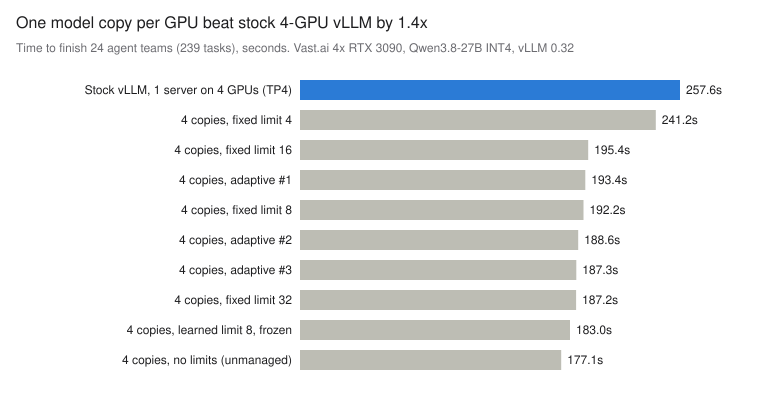

# Benchmark: 4× RTX 3090 on Vast.ai (2026-11-08)

The first real-hardware test of the orchestrator, run on a rented 4× RTX 3090
machine.

## Summary

- **One model copy per GPU finished the agent workload 1.4× faster than stock
  vLLM split across all four GPUs** (177–183s vs 257.6s for the same 239 tasks).
- **The coordinator's per-GPU limits and prefix-aware routing added nothing on
  top.** Every card ran out of KV cache memory at about 20 concurrent requests,
  so vLLM was already queueing the rest itself.
- **Prefix caching barely worked (7–13% hits)** on this hybrid model, for the
  same memory reason.
- **On 20 GB cards, KV memory is the constraint to plan around.** With this
  model, four copies would leave each card room for only 3–4 requests. Two
  servers of 2 GPUs each (2× TP2) is the layout to try first; see
  [What this means for 20 GB cards](#what-this-means-for-20-gb-cards).



## Setup

| Item | Value |
| --- | --- |
| Machine | Vast.ai, 4× RTX 3090 24GB, no NVLink |
| Model | [RedHatAI/Qwen3.8-27B-INT4](https://huggingface.co/RedHatAI/Qwen3.8-27B-INT4), a hybrid attention + Mamba-style model |
| Server | vLLM 0.32.0, started by `scripts/launch_vllm.sh`, one server per GPU on ports 9000–9003 |
| vLLM flags | `--max-model-len 8192 --max-num-seqs 40 --max-num-batched-tokens 2048 --enable-prefix-caching --limit-mm-per-prompt {"image":0,"video":0}`, `PYTORCH_CUDA_ALLOC_CONF=expandable_segments:True` |
| KV cache per card | 4.28 GiB = 60,757 tokens, in blocks of 1,568 tokens |
| Stock comparison | One vLLM server, `--tensor-parallel-size 4`, otherwise default settings, same model and context length |
| Workload | `scripts/bench.py`: agent "teams" that plan, fan out into 4–10 section writers, then review and write a final summary. Each team's tasks share a 1–3k-token brief as the system prompt. Same seed for every run. |
| Sizes | 24 teams (239 tasks) and 96 teams (972 tasks) |

Launch command used for the 4-copy runs:

```bash
PYTORCH_CUDA_ALLOC_CONF=expandable_segments:True \
MODEL=RedHatAI/Qwen3.8-27B-INT4 BASE_PORT=9000 MAX_MODEL_LEN=8192 \
EXTRA_ARGS='--limit-mm-per-prompt {"image":0,"video":0} --max-num-seqs 40 --max-num-batched-tokens 2048' \
./scripts/launch_vllm.sh
```

## Results

All runs are in [`vast-4x3090-runs.csv`](vast-4x3090-runs.csv). Per-GPU limit
means the most requests the coordinator lets one server run at once;
"unmanaged" means no limit, no prompt budget and round-robin routing, so
every ready task goes straight to vLLM.

### 24 teams (239 tasks)

| Run | Layout | Coordinator setting | Makespan | Output tok/s |
| --- | --- | --- | --- | --- |
| 9 | Stock, 1 server TP4 | unmanaged | 257.6s | 376 |
| 1 | 4 copies | fixed limit 4 | 241.2s | 401 |
| 2 | 4 copies | fixed limit 8 | 192.2s | 504 |
| 3 | 4 copies | fixed limit 16 | 195.4s | 496 |
| 4 | 4 copies | fixed limit 32 | 187.2s | 517 |
| 5–7 | 4 copies | adaptive (learns its limit) | 193.4s, 188.6s, 187.3s | 500–517 |
| 8 | 4 copies | learned limit (8 on every GPU), frozen | 183.0s | 529 |
| 10 | 4 copies | unmanaged | 177.1s | 547 |

Prefix-cache hits were recorded from run 10 onward (11.9% in run 10).

### 96 teams (972 tasks)

| Run | Layout | Coordinator setting | Makespan | Prefix-cache hits |
| --- | --- | --- | --- | --- |
| 11 | 4 copies | unmanaged (round-robin) | 652.6s | 10.8% |
| 12 | 4 copies | limit 40 + prefix-aware routing | 666.2s | 7.2% |

The simulator had predicted run 12 would win by about 18%, on the assumption
that routing each team to one card would keep its brief cached. It didn't,
because the cards had no memory left to cache it (see the root cause below).

## What the numbers mean

- **Layout is the win.** Four independent copies beat one tensor-parallel
  server by 1.4×. Without NVLink, the TP4 server synchronises all four cards
  over PCIe at every step.
- **Limits above 8 per card did not shorten the job.** Higher limits did raise
  throughput per card mid-run (about 160 tok/s at 8 streams vs 230 tok/s at 32,
  from the timelines), but each task got about 3× slower. That stretched the
  longest plan → section → review → final chain by about as much as the
  throughput gained.
- **The adaptive controller learned 8 on all four GPUs,** and its frozen run
  was the fastest managed run (183s). It maximises throughput per measurement
  step, which is not quite the same as finishing soonest. With no limits at
  all the job took 177s, within run-to-run noise.
- **The last ~30% of every run is a dependency tail.** The average number of
  running tasks drops from 32 to about 8 while reviews and final summaries wait
  on each other. No limit setting changes this; per-stream speed does.
- **Prefix-aware routing gained nothing** because prefix caching barely worked
  (next section).

## Root cause: the KV cache fills at about 20 requests per card

The vLLM logs show every card peaked at **20 running requests, never the 40
allowed**, with KV cache usage at 100% and up to 152 requests waiting inside
vLLM.

- After the weights (16.8 GiB of the 24 GiB), each 3090 had 4.28 GiB for KV
  cache: 60,757 tokens.
- Because the model is hybrid, vLLM stores attention KV and Mamba state in
  shared pages. That forces a block size of **1,568 tokens**
  (`Setting attention block size to 1568 tokens` in the log), so a card holds
  only about 38 blocks.
- Each request (a 1–3k-token prompt plus up to 600 output tokens) needs about
  2 blocks, so roughly 20 fit at once.
- With every block in use, cached brief prefixes are evicted almost right away.
  Prefixes are also cached only in whole 1,568-token blocks, so a 1.2k-token
  brief can't be cached at all.

So past ~20 requests per card, memory sets the pace. vLLM queues the rest
itself, and the coordinator holding them back instead (at 8 or at 40) changes
little.

## What this means for 20 GB cards

The same model would leave very little KV room on a 20GB card. A rough
estimate scaled from the 3090 logs: 20 GiB × 0.92 utilisation ≈ 18.4 GiB, minus
about 17.6 GiB for weights, activations and CUDA graphs, leaves **about
0.8 GiB, or ~12k tokens**. That is only 3–4 concurrent agent requests per card,
and not enough for even one request near the 8k context limit. These are
estimates to check on the real cards.

| Layout (Qwen3.8-27B 4-bit) | Weights per card | KV room per card | Trade-off |
| --- | --- | --- | --- |
| 4 copies, 1 per GPU | ~16.8 GB | ~0.8 GB (3–4 requests) | No syncing, but starved for memory |
| **2× TP2 (2 servers of 2 GPUs)** | ~8.4 GB | ~9 GB | Syncs only between 2 cards; plenty of KV room |
| 1× TP4 | ~4.2 GB | ~13 GB | Most room, but was 1.4× slower on the 3090s |

**Recommendation: start with 2× TP2 and the coordinator in front of it,** then
benchmark all three layouts with `scripts/bench.py`. A board that gives every
card a full PCIe 4.0 x16 slot helps any split layout. The coordinator
is still worth running on top:

- it starts each agent task the moment its inputs are ready, which no plain
  server does for you;
- it splits work across the 2 servers and keeps each team on one of them,
  where the brief can actually stay cached with ~9 GB of KV room;
- it records timelines and metrics.

Leave its throttling off: no per-GPU limit, or a limit equal to vLLM's
`--max-num-seqs`.

Other ways to get more requests per card, worth testing:

1. `--kv-cache-dtype fp8` to roughly halve attention KV size. Check how much
   of each page is Mamba state, which may not shrink.
2. A smaller or non-hybrid 4-bit model (14B class). This frees several GB per
   card, and prefix caching works normally on non-hybrid models.

## Practical notes from the run

- Use a 4-bit build made for vLLM (AWQ, GPTQ, W4A16 or compressed-tensors).
  GGUF repos don't load in vLLM.
- Give the instance at least 60 GB of disk; the first try ran out at 24 GB.
- On Vast's vLLM template, stop only the template's own vLLM entry in
  Supervisor. `supervisorctl stop all` also stops Jupyter and the web portal.
- Qwen3.8-27B needs `--max-num-seqs` at or below the number of Mamba cache
  blocks vLLM reports (42 here), or it refuses to start.
- `launch_vllm.sh stop` now also kills vLLM's EngineCore child process, which
  used to keep holding the GPU after a stop.

## Next steps for the coordinator

- Default to no per-GPU limit for vLLM backends; keep the adaptive limit as an
  option for servers that degrade under load.
- Let the controller read vLLM's own running, waiting and KV-usage metrics, so
  it can tell when memory is the limit.
- Recalibrate the simulator preset from these logs (real KV capacity, block
  size and weak prefix caching).
- Add a "GPUs per server" option to `launch_vllm.sh` for TP2 layouts.
- Re-run this benchmark on 20 GB cards (e.g. RTX 3080 20GB), with and without
  `--kv-cache-dtype fp8`.
